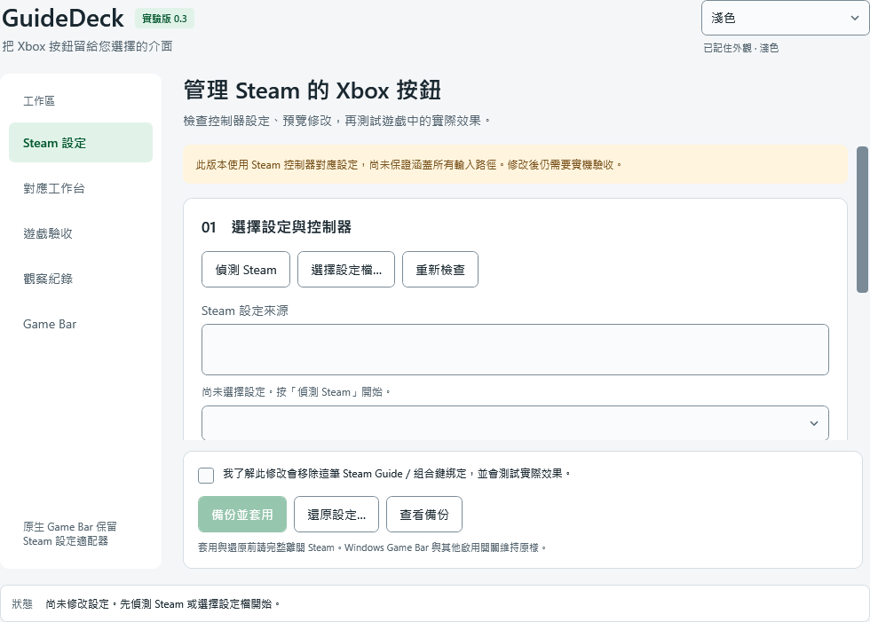
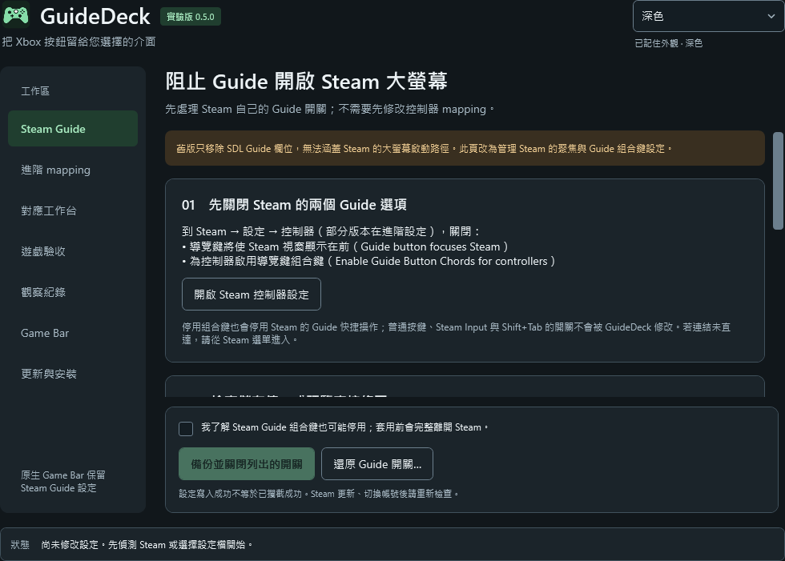

**GuideDeck · Xbox Button Changer**

保留 Windows 原生 Xbox 按鈕 → Game Bar，研究移除 Steam 同時聚焦、進入 Big Picture 或開啟遊戲 Overlay 的行為。

[建置狀態](https://github.com/shenlee377/xbox-buttom-changer/actions) · [下載版本](https://github.com/shenlee377/xbox-buttom-changer/releases) · [完整操作與驗收](README.txt)

目前是 **0.3 實驗版**：以可還原的 SDL mapping 適配器驗證需求，尚未實作全系統輸入攔截。移除 `guide:bN` 不保證 Steam 的每條輸入路徑都被阻止，實際效果需要在 Windows、Steam 與實體手把上驗收。

**這版可以做什麼**

- 左側導覽與分步卡片、固定主要操作，以及系統／淺色／深色外觀。
- 即時跟隨 Windows 主題；高對比優先，同套件 widget 與桌面版共用偏好。
- [介面設計與外觀規則](docs/UI-DESIGN.txt)。

- 偵測 Steam 設定，選擇個別 GUID／CRC 的控制器 mapping。
- 預覽並只移除 Guide 欄位；不修改 Game Bar、Steam Input 或整體 Overlay 開關。
- 只備份選中的 mapping；局部還原可保留其他 Steam 設定的後續變更。
- 偵測設定漂移、撤銷過期預覽、保存與匯出有範圍的人工驗收紀錄。
- Game Bar widget 可使用同一套 mapping 規則、開啟同套件桌面管理器、查看最近檢查摘要。

**實際介面預覽**

以下圖片來自已通過驗證的 Windows WPF 程式渲染，並非概念稿。

| 淺色 | 深色 |
| --- | --- |
|  |  |

**取得與安裝**

從 [Releases](https://github.com/shenlee377/xbox-buttom-changer/releases) 下載 `GuideDeck-windows-x64.zip`，解壓縮後執行 `GuideDeck.exe`。不需要另外安裝 .NET runtime。

也提供[單檔免安裝 EXE](https://github.com/shenlee377/xbox-buttom-changer/releases/download/v0.3.0/GuideDeck.exe)；[ZIP](https://github.com/shenlee377/xbox-buttom-changer/releases/download/v0.3.0/GuideDeck-windows-x64.zip) 較小。兩者都是桌面版，並非 Game Bar widget 的自動安裝程式。

也可下載並檢視 `Install-GuideDeck.ps1` 後執行：

```powershell
.\Install-GuideDeck.ps1 -Version v0.3.0
```

腳本下載對應版本、核對 SHA-256、安裝到 `%LOCALAPPDATA%\Programs\GuideDeck`，並建立開始功能表捷徑，不需要管理員權限。移除腳本保留備份／觀察與 Steam 設定。這是未簽章的開發版；若政策不允許執行腳本，可使用免安裝 ZIP，腳本不修改 Windows 安全設定。

[下載安裝腳本](https://github.com/shenlee377/xbox-buttom-changer/releases/download/v0.3.0/Install-GuideDeck.ps1) · [校驗檔](https://github.com/shenlee377/xbox-buttom-changer/releases/download/v0.3.0/SHA256SUMS.txt)

Game Bar 需要額外的 UWP 開發套件建置與部署；桌面 ZIP 不會自動安裝 widget。開啟桌面管理器可能切出遊戲。詳細步驟見 [README.txt](README.txt)。

**從原始碼建置**

```powershell
dotnet run --project tests/GuideDeck.Tests -c Release
.\scripts\build-windows.ps1
# Visual Studio 2022 UWP tools + Windows SDK 19041 或更新版本：
.\scripts\build-windows.ps1 -IncludeGameBar
```

GitHub Actions 分別執行核心測試與 Windows 桌面／UWP 建置。成功建置不代表手把行為或反作弊相容性已驗證；請閱讀 [VALIDATION.txt](VALIDATION.txt)。

0.3 的 [Windows CI 驗證](https://github.com/shenlee377/xbox-buttom-changer/actions/runs/41070851997)已通過：60 項核心測試、深淺色對比、實際 UI 渲染、系統主題即時切換、手動外觀覆寫，以及桌面／UWP 建置、啟動與安裝流程。

後續發版可在 Actions 選 **Publish verified release**，填入成功的主分支建置 run ID 和新版本 tag。流程會取用該次已測試的產物、驗證校驗、上傳 EXE／ZIP／腳本並發布 prerelease；拒絕覆蓋已發布版本，不需在本機重新打包。

亦可在主分支更新 `.github/release-request.json`，指定成功建置的 `runId`、`version` 與 `mode`：`preview` 保存該次實際介面圖片供檢查，`publish` 發布已驗證產物。兩種方式均檢查建置來源與成功狀態；公開 Release 不會被覆蓋。

**實機驗收目標**

保持 Steam Input、Steam Overlay 和 Windows 控制器開啟 Game Bar 功能可用。分別在桌面與遊戲中確認：Guide 只開 Game Bar、不聚焦 Steam、不進 Big Picture、不開 Steam Overlay；遊戲內 Shift+Tab、普通按鍵、扳機與震動仍正常。

沒有驅動、遊戲／Steam 程序注入、記憶體修改或全域鍵盤模擬。其他啟動器尚未支援。
