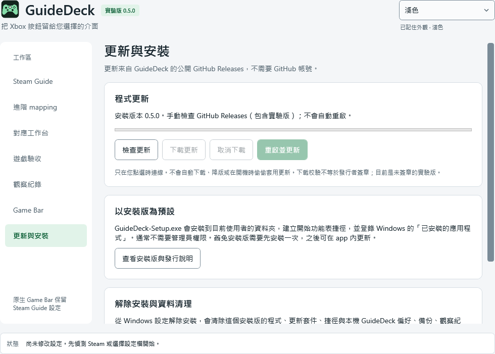
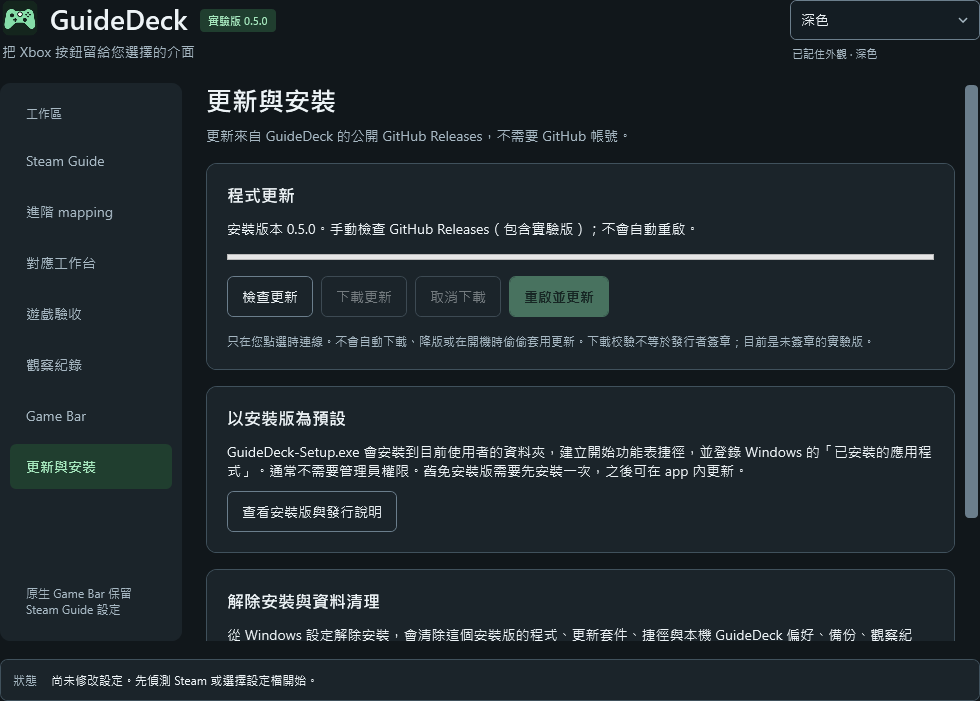

**GuideDeck · Xbox Button Changer**

保留 Windows 原生 Xbox 按鈕 → Game Bar，研究移除 Steam 同時聚焦、進入 Big Picture 或開啟遊戲 Overlay 的行為。

[建置狀態](https://github.com/shenlee377/xbox-buttom-changer/actions) · [下載版本](https://github.com/shenlee377/xbox-buttom-changer/releases) · [完整操作與驗收](README.txt)

目前是 **0.5.0 實驗版**：預設使用安裝版，支援 app 內 GitHub Releases 更新及 Windows 設定解除安裝。針對「按 Guide 仍進 Steam 大螢幕」改用 Steam 自己的聚焦與導覽鍵組合鍵開關。舊版僅移除 SDL mapping 並不夠；此版仍沒有全系統輸入攔截驅動，效果需實機驗收。

**按 Guide 仍開啟 Steam 大螢幕：先做這件事**

在新首頁 **Steam Guide** 開啟 Steam 控制器設定，關閉這兩個選項（部分版本放在進階設定）：

- **導覽鍵將使 Steam 視窗顯示在前 / Guide button focuses Steam**。
- **為控制器啟用導覽鍵組合鍵 / Enable Guide Button Chords for controllers**。

Valve 的 [2025-09-09 更新](https://steamcommunity.com/games/593110/announcements/detail/500583527919651040?l=english)指出，停用 Guide 組合鍵後，Guide 不再開啟大螢幕。這也會停用 Steam 的 Guide 快捷操作；GuideDeck 不改動整體 Steam Input、Overlay 或 Game Bar 開關。

完整離開 Steam 後，可在 app 選取目前帳號的 `localconfig.vdf` 或安裝目錄 `config.vdf`，檢查已存值並預覽直接關閉已知開關。只修改已存在且格式明確的 0/1 欄位，提供局部備份／還原；缺少欄位標示未知，請使用 Steam 原生設定，不猜測新增。切換帳號或 Steam 寫回設定後需重新檢查。

重啟 Steam，在背景、Steam 前景與遊戲中分別測試單按／連按／長按 Xbox 鈕。設定已寫入不等於行為已驗證；[研究依據與範圍](docs/STEAM-GUIDE-RESEARCH.txt)。

原創手把圖標已套用至 EXE、視窗、程式標頭與 Game Bar 套件。[SVG／PNG 原始素材](assets/branding) · [ICO](src/GuideDeck.Desktop/Assets/GuideDeck.ico)。

**這版可以做什麼**

- Steam Guide 專頁管理兩個原生 Guide 開關，不再以 mapping 當成主要修正。
- 多帳號來源選擇、局部備份／還原、重新讀回與設定漂移提醒。
- 左側導覽與分步卡片、固定主要操作，以及系統／淺色／深色外觀。
- 即時跟隨 Windows 主題；高對比優先，同套件 widget 與桌面版共用偏好。
- [介面設計與外觀規則](docs/UI-DESIGN.txt)。

- 偵測 Steam 設定，選擇個別 GUID／CRC 的控制器 mapping。
- 預覽並只移除 Guide 欄位；不修改 Game Bar、Steam Input 或整體 Overlay 開關。
- 只備份選中的 mapping；局部還原可保留其他 Steam 設定的後續變更。
- 偵測設定漂移、撤銷過期預覽、保存與匯出有範圍的人工驗收紀錄。
- Game Bar widget 可使用同一套 mapping 規則、開啟同套件桌面管理器、查看最近檢查摘要。

**統一內嵌介面與手把操作**

0.5.0 先在開發版 Game Bar widget 接入原生錄影 API：開始、停止與儲存最近片段。使用自己的可聚焦按鈕，無須向遊戲模擬快捷鍵；依宿主版本與背景擷取能力啟用。未部署 widget 時桌面安裝版不會顯示遊戲內錄影控制。實機遊戲擷取與手把操作仍待驗收。

[架構與手把操作提案](docs/OVERLAY-HUB-DESIGN.txt) · [Steam API 調查](docs/research/STEAM-API-REVIEW.txt) · [第三方來源能力研究](docs/research/overlay-providers.research.json)

重點是分開驗證「能呼叫、能用手把操作、能返回遊戲、能排除輸入競爭」，並優先提供可直接用手把完成的功能面板。多來源分派、OBS／音訊／Playnite 適配器與通用手把滑鼠模式仍是後續開發，**0.5.0 不聲稱已完成**。

**實際介面預覽**

以下圖片來自 0.5.0 已通過驗證的 Windows WPF 程式渲染，並非概念稿。

| 淺色 | 深色 |
| --- | --- |
|  |  |

安裝版的更新頁（同樣來自實際安裝後的程式渲染）：

| 淺色 | 深色 |
| --- | --- |
|  |  |

**取得與安裝**

預設改用 **[GuideDeck-Setup.exe 安裝版](https://github.com/shenlee377/xbox-buttom-changer/releases/download/v0.5.0/GuideDeck-Setup.exe)**：登錄 Windows 已安裝的應用程式，並在 app「更新與安裝」直接檢查、下載與確認重啟。更新透過 GitHub Releases + Velopack，不需要 GitHub 帳號。首次從舊版升級需安裝一次。

從 Windows 設定解除安裝會清除程式與本機 GuideDeck 資料（**包含備份／觀察**）；請先還原需要復原的 Steam 修改或匯出備份。自行匯出、舊免安裝副本、另行部署的 widget 與 Windows 記錄分別管理。

[更新與解除安裝規則](docs/UPDATING-AND-UNINSTALL.txt) · [學生／開源成本規劃](docs/research/STUDENT-RESOURCES.txt) · [更多遊戲 API 評估](docs/research/GAMING-API-OPPORTUNITIES.txt)

以下 ZIP／腳本保留為選用方式，不提供新安裝版的 app 內更新：

從 [Releases](https://github.com/shenlee377/xbox-buttom-changer/releases) 下載 `GuideDeck-windows-x64.zip`，解壓縮後執行 `GuideDeck.exe`。不需要另外安裝 .NET runtime。

也提供[單檔免安裝 EXE](https://github.com/shenlee377/xbox-buttom-changer/releases/download/v0.5.0/GuideDeck.exe)；[ZIP](https://github.com/shenlee377/xbox-buttom-changer/releases/download/v0.5.0/GuideDeck-windows-x64.zip) 較小。兩者都是桌面版，並非 Game Bar widget 的自動安裝程式。

也可下載並檢視 `Install-GuideDeck.ps1` 後執行：

```powershell
.\Install-GuideDeck.ps1 -Version v0.5.0
```

選用腳本下載對應版本的免安裝 ZIP、核對 SHA-256、安裝到 `%LOCALAPPDATA%\Programs\GuideDeck`，並建立開始功能表捷徑，不需要管理員權限。移除腳本保留備份／觀察與 Steam 設定。這是未簽章的開發版；若政策不允許執行腳本，可使用免安裝 ZIP，腳本不修改 Windows 安全設定。

[下載安裝腳本](https://github.com/shenlee377/xbox-buttom-changer/releases/download/v0.5.0/Install-GuideDeck.ps1) · [校驗檔](https://github.com/shenlee377/xbox-buttom-changer/releases/download/v0.5.0/SHA256SUMS.txt)

Game Bar 需要額外的 UWP 開發套件建置與部署；桌面 ZIP 不會自動安裝 widget。開啟桌面管理器可能切出遊戲。詳細步驟見 [README.txt](README.txt)。

**從原始碼建置**

```powershell
dotnet run --project tests/GuideDeck.Tests -c Release
.\scripts\build-windows.ps1
# Visual Studio 2022 UWP tools + Windows SDK 19041 或更新版本：
.\scripts\build-windows.ps1 -IncludeGameBar
```

GitHub Actions 分別執行核心測試與 Windows 桌面／UWP 建置。成功建置不代表手把行為或反作弊相容性已驗證；請閱讀 [VALIDATION.txt](VALIDATION.txt)。

0.5.0 的 [Windows CI 驗證](https://github.com/shenlee377/xbox-buttom-changer/actions/runs/41157157073)已通過：84 項核心測試、8 項發版驗證測試、深淺色對比、免安裝／安裝版實際 UI 渲染、系統主題即時切換，以及桌面／UWP 建置、啟動與安裝流程。另實際測試安裝登錄、損壞更新拒絕、0.5.0 → 本地測試產物 0.5.1 更新／重啟、更新保留資料、解除安裝清除程式／資料／暫存／捷徑／登錄及不跟隨 junction 誤刪外部檔案。實際 Steam／手把／Game Bar 擷取仍待驗收。

後續發版可在 Actions 選 **Publish verified release**，填入成功的主分支建置 run ID 和新版本 tag。流程會取用該次已測試的產物、驗證校驗、上傳 EXE／ZIP／腳本並發布 prerelease；拒絕覆蓋已發布版本，不需在本機重新打包。

亦可在主分支更新 `.github/release-request.json`，指定成功建置的 `runId`、`version` 與 `mode`：`preview` 保存該次實際介面圖片供檢查，`publish` 發布已驗證產物。兩種方式均檢查建置來源與成功狀態；公開 Release 不會被覆蓋。

**實機驗收目標**

保持 Steam Input、Steam Overlay 和 Windows 控制器開啟 Game Bar 功能可用。分別在桌面與遊戲中確認：Guide 只開 Game Bar、不聚焦 Steam、不進 Big Picture、不開 Steam Overlay；遊戲內 Shift+Tab、普通按鍵、扳機與震動仍正常。

沒有驅動、遊戲／Steam 程序注入、記憶體修改或全域鍵盤模擬。其他啟動器尚未支援。
